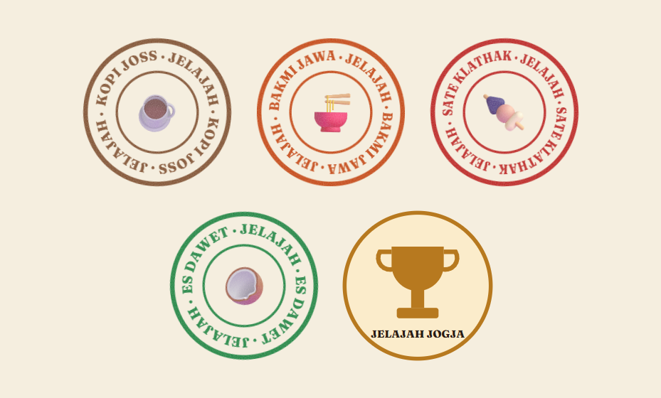

# Jelajah



**Live demo:** https://jelajah-bch.vercel.app (mirror: https://pugarhuda.github.io/jelajah/) · **Deck (Widget Factory template):** https://jelajah-bch.vercel.app/deck.pdf · **Video (75 s):** https://jelajah-bch.vercel.app/jelajah.mp4 (vertical: https://jelajah-bch.vercel.app/jelajah-vertical.mp4) · **Media Track entry:** https://dorahacks.io/buidl/51515

**For judges, in 60 seconds:** [the story in 6 panels](https://jelajah-bch.vercel.app/#/story) · [live levy rally genesis](https://blockchair.com/bitcoin-cash/transaction/e0ed3240f589bafe01996f2a8f54a4f32077ecb212df24a7cfcdb2ab6c19752e) · [a mainnet claim that paid the reward and minted a trophy](https://blockchair.com/bitcoin-cash/transaction/0e071a4648f8ac6ab48bf97f48e72ff473dfd5af3fa3bc6a131e5974ab528b33) · [the same claim through the XO engine](https://blockchair.com/bitcoin-cash/transaction/70efa57cbf453afedf32efd76bbc8ef513fb4d7105d473c79afd537de8b3ac0e) · [stats read from the chain](https://jelajah-bch.vercel.app/#/stats) · [a stall's printable poster](https://jelajah-bch.vercel.app/#/stall/1) · [the one-page guide for stall owners](https://jelajah-bch.vercel.app/stall-guide.pdf) · `npm run check` runs 84 VM checks of the contracts.

**A stamp rally on Bitcoin Cash.** Pay a stall and its stamp NFT is printed in the same transaction. Collect stamps from 3 different stalls, burn them, and the rally's contract pays you back and mints your trophy.

**Not a loyalty card, a rally.** A loyalty card is one shop paying back its own customers. Jelajah puts **many independent stalls behind one shared prize pool** that pays only for stamps from *different* stalls, and the pool can't be drained even if stalls collude: in a levy rally, colluding stalls end up paying the prize themselves.

**▶ Try it on mainnet in 2 minutes (about 12,000 sats in, 3,000 back: a few US cents).** Open https://jelajah-bch.vercel.app, press **Connect wallet** and scan with Selene or Paytaca (WizardConnect). Then:
1. Buy at 3 stalls: 4,000 sats each (1,500 to the stall + a 2,500 levy into the prize pool), plus about 500 in fees.
2. Press **Claim**: 3,000 sats come back, along with a Trophy NFT. Your set's own levies paid that reward, which is why colluding stalls can't drain the pool.
3. Optional: buy at the 4th stall too and the claim becomes the **bonus tier** (4,500 sats). Or buy again after claiming and the button shows **★ member price**: your trophy is your membership card.

Every step is one wallet prompt, and each one is a real covenant transaction on BCH mainnet.

*Jelajah* is Indonesian for "to roam, to explore". The demo rally, **Jelajah Jogja**, has four Yogyakarta street-food stalls.

Built from scratch for **BCH BLAZE 2026** (Mainnet track). The first commit is from 17 Nov 2026, and there is no pre-existing code.

## Why

- **Stalls:** small food stalls have no cheap way to bring in new customers, and a loyalty card only works at one shop.
- **Stamp rallies:** collecting stamps across many places for a prize already works on paper (eki stamps in Japan, mall and food-festival promos in Indonesia). But paper stamps are easy to fake, and the prize depends on the organizer keeping their word.
- **Jelajah** makes every stamp proof of a real, paid visit, and locks the prize money in a contract.

## How it works

| Step | Who | On chain |
|---|---|---|
| 1. Open a rally | Organizer | Genesis of one token category: one **minting NFT per stall** (each held by that stall's `StampMinter` covenant) and one for the `RewardVault`, which also holds the reward pool. |
| 2. Buy | Customer | One transaction spends the stall's minter and pays the stall at least its price. The minter only lets a stamp out to the buyer if that payment is there. Stamp commitment = `stall id ‖ buyer pkh`. |
| 3. Claim | Customer | One transaction burns stamps from `needed` different stalls. The vault loops over them and checks: same category, stall ids strictly increasing (so all different), all bought by the same pkh. It pays the reward to that pkh and mints a **Trophy** NFT (stall id `00`). |
| 4. Close | Organizer | After `endTime`, `reclaim` returns whatever is left. Before that, the pool cannot be touched. |

There is no server and no database. State lives in UTXOs and NFT commitments, and the app reads the chain over Electrum from the browser.

### Contracts (`contracts/`, CashScript 0.14)
- `StampMinter.cash`, 94 bytes: `stamp()`.
- `RewardVault.cash`, 170 bytes: `claim()` (uses the 2026 VM's loops) and `reclaim()`.
- `StampMinter2.cash`, 152 bytes, used by new rallies: `StampMinter` plus a **member price**. Your trophy becomes a membership card. Show it as input 1 and every stall charges you its `memberPrice`, as long as the trophy (commitment `00 ‖ your pkh`) goes straight back to you at output 3. Only the vault can mint `00`, a traded trophy doesn't match your pkh, and keeping the discount while sending the trophy elsewhere is rejected.
- `StampMinter3.cash` (167 bytes) + `RewardVault2.cash` (288 bytes), **levy rallies**, optionally with a **bonus tier**: burn `bonusNeeded` different stalls (more than `needed`) for `bonusReward`. A claim takes the bonus path exactly when input `bonusNeeded` is also a rally stamp, so you can't take the small reward while burning a bonus set, or the bonus for a small set. The deploy rules (anti-farming, anti-collusion) are checked again at the bonus size. Every stamp must also pay `levy` sats to the vault address in the same transaction (output 3). The levy coins pile up next to the vault, so buyers never race for the vault coin. `merge()` lets **anyone, without a signature** fold them into the vault coin. Every input checks that the only output is the vault itself, still carrying its minting NFT and holding everything minus at most 600 sats per input, and never less than the vault coin itself, so levies can only ever grow the pool. The deploy script requires `needed × (levy − 600) − 600 ≥ reward`, so each set's reward is paid by the levies of the stamps it burns. Config: `scripts/rally.levy.config.json`.
- **Proof of presence** (optional per stall, `StampMinter3`, 200 bytes). A stall with a `presenceKey` only mints when its device signed `rallyCategory ‖ stall id ‖ buyer pkh ‖ the minter outpoint this stamp spends` (`checkDataSig`). The buyer's app shows their buyer code as a QR. The stall's phone (`#/device/<id>`, which keeps its key in the browser) scans it and shows the signature as a QR, and the buyer scans that back before paying. Scanning uses the browser's own `BarcodeDetector`, and the code can always be pasted instead. The signature names the buyer, so a screenshot shared online is useless to anyone else. It also names the exact minter coin, which every stamp spends and recreates, so **each code works once**. The app picks the lane before showing the buyer's code (`pkh:txid:vout`). If another buyer happens to use that lane first, the stall just signs again.
- **Lanes:** each stall gets several minter coins at the same covenant address (`lanes` in the config), and the app picks one at random, so two people buying at the same stall in the same second don't fight over one coin. The contract needed no change, because each lane hands its minting NFT back to itself.

### Threat model
| Attack | Why it fails |
|---|---|
| A stall buys from itself to farm rewards | A set needs N different stalls, and the deploy script enforces **reward < the cheapest full set**, so farming loses money. |
| Buying second-hand stamps to claim | Stamps can be traded as collectibles, but the reward and trophy always go to the pkh that bought them. |
| The organizer runs off with the pool | The vault only pays out through `claim()` until `endTime`. |
| Extra stamps minted / a minter drained | Minter value and token must come back unchanged, and no other output may carry tokens. |
| A trophy reused as a stamp | Trophy id `00` can never satisfy `id > prev` starting from 0. |
| Bonus for a small set, the small reward while burning a bonus set, or a bonus set with a repeated stall | `RewardVault2` decides the tier from the inputs themselves (input `bonusNeeded` is a rally stamp or not) and loops over that many strictly increasing stall ids (3 VM attack tests). |
| Buying a presence stall's stamp without being there (a shared screenshot of the stall's code, another device's key, another stall's code, replaying a used code) | The signature must be the stall device's, over this rally, this stall, *this* buyer's pkh and the minter coin being spent, which no longer exists after use (5 VM attack tests). |
| Member discount without a trophy, with someone else's trophy, or while keeping the trophy away from its owner | `StampMinter2` only lowers the price when input 1 is a rally trophy whose commitment is `00 ‖ buyer pkh`, and it requires that exact trophy back at the buyer's address. The anti-farming check uses the member price. |
| **Every stall in a set colludes** with a buyer and refunds them off-chain | **Closed by levy rallies (`StampMinter3` + `RewardVault2`).** Each stamp pays a levy into the pool and the levies of one set cover its reward, so the colluding stalls fund the payout themselves and nothing is gained. VM test: `carol's set was paid from its own levies`. Levy coins can't be redirected, burned as fee, skimmed, pocketed inside a claim, or used to pay a merge's fee out of the pool (6 attack tests). **In the original StampMinter / StampMinter2 rallies, this is not prevented on chain.** The buyer pays only fees, so the pool can be drained one reward at a time. The price rule only stops a single cheater. A merchant co-signature doesn't help (the merchants are the colluders), and one claim per pkh is beaten by using many addresses. The real fix is governance: **the stalls fund the pool themselves** in proportion, so colluding only drains their own money. (In the demo every stall payment goes to the organizer, who also funds the pool, so the risk is zero.) An optional organizer co-signature on each stamp is the centralized alternative. |

## Try it
Open the demo, press **Connect wallet**, and scan the code with Selene or Paytaca (WizardConnect). Buy at 3 stalls, then claim.

## Run it
```bash
npm install
npm run check     # compiles the contracts and runs the full rally, including attacks, against the BCH VM (mock network)
npm run dev       # web app
node scripts/rally.mjs address --network chipnet                 # organizer funding address
node scripts/rally.mjs deploy  --network chipnet [--registry https://<host>/bcmr.json]
node scripts/smoke.mjs --network chipnet                         # real-network end to end: 3 stamps + claim
node scripts/rally.mjs deploy  --network chipnet --config scripts/rally.levy.config.json   # levy rally (anti-collusion)
node scripts/rally.mjs bcmr    --network chipnet --registry https://<host>/bcmr.json   # new BCMR revision (icons) via the authchain, no redeploy
```
**Open your own rally:** `#/organize`. Fill in stalls, prices, the prize and an optional levy. The same rule checks and genesis builder as the CLI (`checkRallyConfig`, `planRally`, `buildGenesis` in `src/lib/tx.js`) run in the browser, and the organizer's wallet signs over WizardConnect. If no vout-0 coin exists, it first signs one send-to-self. The finished rally travels in its share link (`?r=<base64url of the deflate-raw JSON>`, about half the old `?rally=` size so a stall poster's QR stays scannable; old links still work), so there is still no server. The organizer's **reclaim key** is created in the browser, saved there and shown once for backup. After the rally ends, `#/reclaim` signs the vault's `reclaim()` locally with it and sends the leftover pool to any address, with no wallet prompt. The CLI's `reclaim` uses the same `buildReclaim`. After `endTime` the rally page says it has ended. The link is treated as untrusted input: it is shape-checked, and stall colours and text are sanitised.

**Stall locations:** a stall can carry a `place` (an address or `lat,lng`), shown as a 📍 OpenStreetMap link on its card and poster. No map library is needed.

**Stall device key:** `#/device` shows the secret key under "Back up or move this key" and can import one, so a stall can change phones without a new rally.

**Stall till:** `#/till/<stall id>` is the cashier screen. It rings (and vibrates) on every paid stamp as soon as it reaches the mempool, and shows the stall's sales and buyers. Everything comes from the stall covenant's own history (`stallSales` in `src/lib/tx.js`, shared with `#/stats`), so a ring means the covenant already checked the payment.

**Collector pages:** `#/u/<BCH address or npub>` shows what a collector holds in the rally (stamps per stall, how many they bought themselves, trophies) and their verified Jelajah ID, plus a 🔥 streak of consecutive days with a stamp (from block times, Jogja time), all read live from the chain and public relays. `#/stats` links every top collector to theirs.

**Community rallies on Nostr:** after opening a rally on `#/organize`, the organizer can list it on public relays (a signed kind-30078 event carrying the share link's `?r=` payload). `#/rallies` lists them for the current network. Listings are signature-checked, and each rally is checked again by the same link rules when it opens, with the community-rally warning. Still no server.

**Seasons:** every official rally on a network is a season. `#/stats` can add up every season's collectors (trophies, stamps, seasons played), read from each rally's history, and collector pages show their record per rally.

**Wallet metadata for community rallies:** `#/organize` takes an optional https URL for `bcmr.json`. The genesis commits to its hash (the same `bcmrRegistry` the CLI uses), and the organizer downloads the file and hosts it there, unchanged. Without our art, a community rally's registry has names but no icons.

**Gift links:** `#/gift` makes a key in the browser and puts it in the link's `#fragment`, which browsers never send to a server. Fund its address, send the link, and the receiver connects a wallet and sweeps it, so someone with an empty wallet can buy their first stamp. The link is the money: whoever opens it first can take it, and the giver can take it back the same way.

**Quality:** Lighthouse (mobile, 21 Nov): accessibility 100 and SEO 100 on the rally, story, till, collector and gift pages; best practices 100 on most, 96 where the stamps' ring lettering is drawn under 12px. `oxlint` reports no warnings.

**Stall dashboard:** open `#/stats` in the app. Stamps sold, unique buyers, sats paid to each stall and sets claimed, all recomputed in the browser from each covenant's history, plus a **top-collectors** board (stalls visited, stamps, trophies per address). Prices also show a rupiah estimate (a CoinGecko rate, nothing about the user is sent). A transaction only counts if it really spent the covenant (the rally's minting NFT goes back to it at out[0]), so nobody can inflate the numbers by sending junk to a minter address.
`scripts/rally.config.json` sets the stalls, prices, reward and duration. `--merchant-address` pays real stall wallets.

## Extensions on chipnet (20 Nov 2026): sponsors, stalls added mid-rally, passports, bonus trophies

All four are tested against the VM first (`npm run check`, 68 checks, about 40 of them attacks) and then run on chipnet.

- **Sponsored stamps** (`SponsorPool.cash`, 58 bytes). A sponsor, such as a tourism office, hands out voucher tokens and parks subsidy coins in the pool. A buyer adds one subsidy coin and burns exactly one voucher, and pays the stall that much less. The stall's minter still demands the full price, so the subsidy can only reach a stall, and only inside a real stamp purchase of this rally. Only one subsidy coin fits in a purchase. The CLI also refuses a subsidy at or above the cheapest price. Rejected attacks: a voucher of another category, 2 vouchers, a wrong-size coin, the subsidy diverted to the buyer, the subsidy spent outside a purchase. Run: vouchers [`2459de95…`](https://chipnet.imaginary.cash/tx/2459de959a69dd74712a2cd604278f78daf8ca833c4a0ee5be08b48e4bebf7b1), sponsored stamp [`6b9075a6…`](https://chipnet.imaginary.cash/tx/6b9075a6aaf3dd17c14197ff40e44ae1d942895fa3010dc8334236dee958b544).
- **Open a stall mid-rally** (`RewardVault2.addStall`; the vault is 738 bytes). The vault embeds the compiled `StampMinter3` bytecode (generated by `scripts/gen-vault.mjs`). It derives the new stall's minter address on chain from that bytecode plus the stall's parameters, using this rally's levy. The minting NFT can therefore only go to a real stamp minter, never to the organizer. Added stalls use ids 17–127, prices above 16 sats and a P2PKH payout, so every push in the minter script stays a plain, length-prefixed push. The VM test checks that the vault-derived address equals CashScript's address byte for byte. Rejected attacks: a non-organizer signature, the minting NFT sent to the organizer, an id below 17, sats taken from the pool. Organizers use `rally.mjs add-stall` or the organizer tools on `#/reclaim`. The cost: every vault input now reveals about 740 bytes, so a levy merge allows up to 1,000 sats per coin, and the anti-collusion rule counts that. Run: stall #17 opened [`6252cc34…`](https://chipnet.imaginary.cash/tx/6252cc34a7e745c037ddc3bddf29626d03cede272c248b897937ff4b3b363095), a stamp bought there [`9f7291b3…`](https://chipnet.imaginary.cash/tx/9f7291b389e23cb968a9a29f954ed0daa9d3629b60d4bead25abd16d082dc34e).
- **Passport across rallies** (`PassportVault.cash`, 153 bytes). Trade a trophy from rally A and one from rally B, both naming the same owner, for a reward and a Passport NFT of the passport's own category. The trophies are burned, so a pair counts once. Shared as a `?pp=` link and claimed on `#/passport`. Rejected attacks: two trophies from the same rally, someone else's trophy, a stamp passed off as a trophy, the reward redirected, a trophy kept back. Run: passport [`ce123c94…`](https://chipnet.imaginary.cash/tx/ce123c94fefb6cc41044e905ebc5938971914451412a52a653fb7784ce012382), claim [`448ecf59…`](https://chipnet.imaginary.cash/tx/448ecf5970f1e20c5949b4de644f734e0df7a1e9cb7b82d2e201cd14fc913834). The buyer earned the two trophies in the levy rally's bonus claim [`ecbdd9f9…`](https://chipnet.imaginary.cash/tx/ecbdd9f9b557a56c67a6dcd27398c359a935f328b67cfde808d27719c865e5b8) and the presence rally's claim [`b847c76f…`](https://chipnet.imaginary.cash/tx/b847c76fb848e4b6cbe37cf7d7ca2ce31484faa3f8bb6bc625abe15a207ef12e).
- **Bonus trophies.** A bonus-tier claim mints `00 ‖ pkh ‖ 02`, drawn in violet with a star, and it works as a membership card too (`StampMinter3` checks the 21-byte prefix). Member stamp with a bonus trophy: [`e4fcbb7c…`](https://chipnet.imaginary.cash/tx/e4fcbb7c23a2a1cb764f4f1520bd17d3792e9088c40a047cb710bd70df83c9d1).
- **UI tests:** `npm run test:ui` runs 8 Playwright tests against the production build: organizer rule checks, tampered links, the device signature, posters and the language switch.

## Mainnet levy rally (21 Nov 2026, live demo)
The live demo is a **levy rally**: `StampMinter3` + `RewardVault2`, the anti-collusion design, with a bonus tier, member prices and 2 lanes per stall. Add `?net=chipnet` for the test rally. Each stamp: 1,500 sats to the stall (1,200 for trophy holders) + 2,500 levy to the pool. Set of 3 different stalls → 3,000; all 4 → 4,500. Pool seeded with 4 rewards, and every set's levies refill it. Open for 60 days. **Organizer fee without a new contract:** each set's levies (7,500) exceed its reward (3,000) by at least 2,100 sats after merge fees (at most 600 per merged input); that surplus stays in the vault and returns to the organizer with `reclaim` after the end. `#/organize` shows this margin for any levy rally.
- Genesis: [`e0ed3240…`](https://blockchair.com/bitcoin-cash/transaction/e0ed3240f589bafe01996f2a8f54a4f32077ecb212df24a7cfcdb2ab6c19752e) · category `6dd1cc7da85cdb72d7cbe597a505b11197173ebb25c3e49e079c778ac1a5cbf3`
- Reward vault: `bitcoincash:rwh78jaglz5vvz5w793d3zlsw6unl574tn8h5r0shrspwxmlztgmqdlj6sakf`
- BCMR metadata, hash-committed in the genesis: [`bcmr-levy.json`](https://pugarhuda.github.io/jelajah/bcmr-levy.json)
- First levy stamp (Kopi Joss, 1,500 sats to the stall + 2,500 levy to the pool), caught live by the till in the video: [`8718bc42…`](https://blockchair.com/bitcoin-cash/transaction/8718bc42c871cd9e5cb37c0a51c2aced4e488457a3678412161497692b5ea98e)
- **A full levy cycle on mainnet (21 Nov 2026):** stamps at three different stalls ([`8718bc42…`](https://blockchair.com/bitcoin-cash/transaction/8718bc42c871cd9e5cb37c0a51c2aced4e488457a3678412161497692b5ea98e) · [`e38a96c3…`](https://blockchair.com/bitcoin-cash/transaction/e38a96c376715f1e1093d7c8f495af8e5f27ed9ed9b4f172c16306058f090674) · [`d1b5d0fd…`](https://blockchair.com/bitcoin-cash/transaction/d1b5d0fd15261160dd314b7755a851af9e358fc91917a51b4119e0a44fe63419)), each paying its stall and a 2,500-sat levy; an unsigned `merge()` folds the levies into the pool ([`de77ed6e…`](https://blockchair.com/bitcoin-cash/transaction/de77ed6ef2bbabfe7627c767285f3234618f43875924d12393e1bfda0d80a6fc)); the claim burns the set, pays the 3,000-sat reward out of those levies and mints the trophy ([`e411c9b9…`](https://blockchair.com/bitcoin-cash/transaction/e411c9b9730f2f69cf062b83375dff3afbc91f0d02764549c59174ce2ed948ee)). `scripts/buy-one.mjs` and `scripts/claim-one.mjs` rerun it.

## Mainnet rally v2 (19 Nov 2026, retired)
Rally v2 (`StampMinter2`, no levy) was the demo until 21 Nov; its record is `scripts/rally.mainnet-v2.json` and its stamps keep their BCMR in `bcmr.json`. Pool: 4 rewards × 5,000 sats + 1,000 sats dust.
- Genesis: [`4c96cba2…`](https://blockchair.com/bitcoin-cash/transaction/4c96cba232afc690f841ffa7b4e10680de7b3123df4836da50700fa208a2601d) (8 minter coins + vault) · category `082ad61858ea6ad7c75c7f2b1d2cbf8293a61e91fa46464b2e66c0dadcec24ad`
- Reward vault: `bitcoincash:rv603w2k07qrq9dcasfl3u2es204lfzjk42njsnayqgk0gxz2p4xcmuvyrzjf`
- BCMR metadata with stamp and trophy icons, hash-committed in the genesis: [`bcmr.json`](https://pugarhuda.github.io/jelajah/bcmr.json)
- First v2 stamp on mainnet, bought through the `StampMinter2` covenant from a throwaway buyer that was swept back afterwards: [`8b3d8dec…`](https://blockchair.com/bitcoin-cash/transaction/8b3d8deccc37c42ec9e8850dc6483591ee524e5d4c672d89e04eb579ee5bd596). The `#/stats` dashboard picks it up.

## Mainnet rally v1 (19 Nov 2026, retired)
The first mainnet rally, on the original `StampMinter`. It is no longer the demo, but its history is the mainnet end-to-end proof. Its remaining pool comes back after it ends (18 Jan 2027) with `node scripts/rally.mjs reclaim --network mainnet --rally scripts/rally.mainnet-v1.json`. The pool was 30,000 sats but only 5 rewards were claimable, because the vault must keep 1,000 sats of dust under its minting NFT. The deploy script now adds that dust on top of the pool.
- Genesis: [`47f7df27…`](https://blockchair.com/bitcoin-cash/transaction/47f7df27c3142503911eee2fcd76199be91d64fbae0b4fa621041268a65b7f34) · category `026421ea8dc5944c03a0b2151f3c44a89ae307adc0cb828cc25ead05a4c5494f`
- Reward vault: `bitcoincash:r057jerhmlqvykrwg9h8s6y4z8cuzc6856hf7k2n3kagwaz7p5w86nxj262cl`
- BCMR revision 1.1 (icons) published along its authchain in [`85ccbf71…`](https://blockchair.com/bitcoin-cash/transaction/85ccbf7111bd700c9f8ebf899934dd7b26091dc90f05149316137ab019057395)
- **End to end on mainnet** (`smoke.mjs`, 19 Nov 2026): stamps [`60513b45…`](https://blockchair.com/bitcoin-cash/transaction/60513b45ff9fd8be183710554b3707ee3d6f2a71cb963ec025a8a921918c7bba) · [`196503e3…`](https://blockchair.com/bitcoin-cash/transaction/196503e31c0b09f6fdb605c361280b4a2ca4fc263dedca5c9beec7c7371f72e0) · [`a7fb6db1…`](https://blockchair.com/bitcoin-cash/transaction/a7fb6db15732b5c015c59fac9dd5ac8116919b8b17d49591120700c682174521) · claim + trophy [`0e071a46…`](https://blockchair.com/bitcoin-cash/transaction/0e071a4648f8ac6ab48bf97f48e72ff473dfd5af3fa3bc6a131e5974ab528b33)

## Chipnet run, levy rally with a bonus tier (20 Nov 2026, current `?net=chipnet`)
Price 4,000 sats (member 3,600) + a 2,200 sats levy per stamp. Reward 4,000 for 3 stalls, **bonus 5,500 for all 4**. The genesis is built by the shared `planRally`/`buildGenesis` code that the organizer page also uses.
- Genesis: [`a7ba3a49…`](https://chipnet.imaginary.cash/tx/a7ba3a4976fda7a91c3d94fd58915e67174cae908d580ca489364b31949859c4)
- 4 stamps with levy [`a8e6b6ac…`](https://chipnet.imaginary.cash/tx/a8e6b6accb6ba8770e2da00af1222052c3b2d809abef9858019ac0e06f27c042) · [`5e97fa6a…`](https://chipnet.imaginary.cash/tx/5e97fa6a96db9660744ec2c16d4406d0709bb198e36c46460c1f963a6f45bf93) · [`d39efd62…`](https://chipnet.imaginary.cash/tx/d39efd627e67eea6ce5f18d5caa8c6b7d17ad99eb1f7ac3290fdf540e80ba8ae) · [`3e87822a…`](https://chipnet.imaginary.cash/tx/3e87822a39e8491d612976b5b711a005bc813cd4c7d45108ad543b758f93321d)
- **Unsigned merge** of the levies: [`e33259a3…`](https://chipnet.imaginary.cash/tx/e33259a3f5847efc838eccc202deaaf672ce714847862562a7f5561846c083ed) · **bonus claim** (vault paid 5,500) + trophy [`dda26dd1…`](https://chipnet.imaginary.cash/tx/dda26dd123b0498cdd066b86a0a6f4f553c71080edf50b5e0d7354e53838a261) · member stamp [`e2753335…`](https://chipnet.imaginary.cash/tx/e275333599676b11f441ffab84e153ccad0354b7548405e6b8073d3f965aead8)

## Chipnet run, proof of presence (20 Nov 2026, link-only rally)
Levy rally where **Kopi Joss and Bakmi Jawa require their device's signature**, made single-use by binding it to the minter coin. Created with `rally.mjs deploy --config scripts/rally.presence.config.json --out scripts/rally.presence.chipnet.json`. Open it from its [share link](https://jelajah-bch.vercel.app/?r=tZTNjuQ0EMdfxTIXkALyZ2znyLJCOwtotazEAXEo2-V0ppO4sZNpmtU8AkckDkhISPtiPAGPAOn52BkOc1qOLrnK9f_V3_WWzrgcc9nTjobdcJhxoQ2dYULa0Qsc4RJ25CL3l0A-PhSsOAf8hDY0Yg1lOCxDnmlHv8KrEykwjidy3GFBshwzqQuMYyUw1kwK_rgOW3yHQyERr4aAZMmkDv1MUi4EIeyIX09YGnIo-WqY--3yTYgcoW6ngp_RhgZYsM_lRDtqGLhgnUhCap5UMkEYCCjBMmE1D163Xgchk0peBcFRGp-YSTyIII23tKFX07P39byVRgQeTErMeJSCq5B8UkLq0HqvebCaCbAoIQhjgko8SZ2EE8GCM2xDhxgx0k42tOARSqSdYow1FOf4ZtiwcsuYlMI61tBcepiHn7G8Wj3tKJMyKQ4CIbkEFkR0IDhE0JZJzpwKMaBwlrfCcMEScxDsVgyk8K2TIdKGjjBjpZ1o6DTMC5ZzLyNenWgnxNaJz_Nav7ntU92eX982q_V2ZcISdjAvlXbfv6VDpB2_d8XLfBjIRa6VNnSBfhzmLfpsByVkGEnIKSESfzrPry5w9khDccqXw7-M__rt122IecyFdvQjAwqEpw09lCHgHazbui_i3XtQYO5JxD0sW806rFvNCSeP5dVNpmy3zDGHzcumBceViUYYo7B1Dply3Olt_MEx55ngHh1PnEErrIVwbuHG4C9xMwMTnIF1xnJg3kAUEq1tJbYcrRWGSceC5ZiEjFq16GIrBTirvWtF8tohp9fNDTxxD-9z2E8DuYAjPKL3Xc7x07T9kDnnOGJ9AOzvP375_SGxIBRn4SliXw-kz3GXezJBhT1Z1rnfr_8_L81dMkYlEyWPDH2KioNuLbYILXPRbfxYK6JrOYJEhho1Sm8hOKdduucl73l9CwuSlyMsO9g_IvZl3pwAC5xInokfwimMSOoh7_8L78-H8LzjgT8J7_ziHiZ_XkFrXffkEst6OZCKB4zwoTHeaVb3mp9X8gUcz4v4vd4XASMJOeR5XQjMkRxgnEhdeyiP5L5791Au3xZHfEru80r2OMIBSISZ9OsIBAp-8M91_UNDe5yxDvXNT7SjyjIXhGytEFyyZGOyUnGltIxCCWyRu1bYhMbqCKqVljEjwbnQOu10Anr9Dw). The smoke run signed as each stall's device:
- Genesis: [`4809c236…`](https://chipnet.imaginary.cash/tx/4809c236822130f8df83414453d242e6e19628fe785da46380073a99c69595fa) · presence stamps [`7f38aa76…`](https://chipnet.imaginary.cash/tx/7f38aa76b7e4a960fb5d65f287a0118c4aa9fae51fbd9c49c151966d7600404a) (Kopi Joss) · [`873c2e6e…`](https://chipnet.imaginary.cash/tx/873c2e6e220ef5f027327a10aac932606ef242655cc51a9771d7b1bd82c28173) (Bakmi Jawa) · bonus claim [`4c3c03ad…`](https://chipnet.imaginary.cash/tx/4c3c03adf08bc5b4c07cafc8bf844d4f2546d397128f441c7a361f5629421673) · member stamp with presence [`4740fd4b…`](https://chipnet.imaginary.cash/tx/4740fd4b638059314a212eeedbb16c204b862729a123e9502309979b86f360a6)

## Chipnet run, StampMinter2 + 2 lanes per stall (19 Nov 2026)
- Genesis: [`c8f9be79…`](https://chipnet.imaginary.cash/tx/c8f9be79320fe95370fc4a88ad7d2b5f5bf2b0b1fbbcc195fdd5923a2fe05ccc) (8 minter coins + vault)
- Stamps [`1df23b2f…`](https://chipnet.imaginary.cash/tx/1df23b2f4990586f1545489d588e6286fdbf1c208719575a1ff3606ad20e51ee) · [`0542ac61…`](https://chipnet.imaginary.cash/tx/0542ac61b4cb611c58197001657722c556e5990974a16a9a48f9ba4bb34c2165) · [`7e1a8b70…`](https://chipnet.imaginary.cash/tx/7e1a8b70c09698c2a19b81a2dd23c16f37d527b1057dad2241b6f5d56be8db66) · claim + trophy [`9056ff5d…`](https://chipnet.imaginary.cash/tx/9056ff5dc5d2ab2569fd2188d311e5166b9b817f1d0c44a1b11b71167a09d9e1)
- **Member-price stamp** using that trophy (1,800 instead of 2,000 sats, trophy returned): [`14875f6d…`](https://chipnet.imaginary.cash/tx/14875f6d30c42372342efc84372e133c9061986be0074cc5197723f7276dac28)

## Chipnet run (17 Nov 2026, original StampMinter, still used by `xo/`)
- Genesis: [`aa5c20f5…`](https://chipnet.imaginary.cash/tx/aa5c20f53240528ab3fd4ea581cf6a8a42c28cdbdc2a43ffe3035239478dbffc)
- Stamps: [`abaafd90…`](https://chipnet.imaginary.cash/tx/abaafd903a316c9290013e4698ce974cc687195552fc5f3b6c6c0ff3f93de9b9) · [`b3d2ae3b…`](https://chipnet.imaginary.cash/tx/b3d2ae3bd6fcf910ee9f6798620dc10a3a321ce816a5b01205d166dd9fc1c292) · [`a4d05c49…`](https://chipnet.imaginary.cash/tx/a4d05c49b719b044196134335a4af6f4cca38d6329f5b79bebbf31cc6a113aa9)
- Claim + trophy: [`33d11924…`](https://chipnet.imaginary.cash/tx/33d119246e891151d6735d0159392e7c30b6eda67e84f33af8fd98f52b9c93b9)

## Real-wallet tests of the new features (Selene, chipnet, 20 Nov 2026)
- **Organizer page:** Selene paired over WizardConnect on `#/organize`, then signed the genesis of "Selene organizer test": 3 stalls × 2 lanes plus the vault. Genesis: [`c2ba873d…`](https://chipnet.imaginary.cash/tx/c2ba873dd6f615ca1cb36d531beebe0c7c4e85fde1f852a74262cb91f8b3c197). The share link it produced loaded with the community-rally warning, and the wallet session carried over.
- **Proof of presence:** on the presence rally, the buyer panel showed Selene's code (pkh + lane coin), a second tab running `#/device/1` signed it, the panel verified it locally, and Selene approved the purchase showing the `01 ‖ pkh` stamp: [`732fc91b…`](https://chipnet.imaginary.cash/tx/732fc91b55ba015d5317c7798cf71fcf544811b7310957a802dba5f4d6f1c58b).

- **Reclaim from the browser:** an already-ended rally opened from `#/organize`. Selene signed the send-to-self preparation and then the genesis, and `#/reclaim` took the pool back with the browser-held key: [`989d8d6e…`](https://chipnet.imaginary.cash/tx/989d8d6ebeabc0caafc7c11e2bfd2b5300571b11ec68b518414ea1bc32cc4ae0).

## Real-wallet test (Selene, chipnet, 17 Nov 2026)
Selene Wallet connected over WizardConnect, signed three purchases and the claim. The burned stamps (`01`, `02`, `03`) and the minted trophy (`00`) showed up in Selene's own signing screen:
stamps [`165bffba…`](https://chipnet.imaginary.cash/tx/165bffba2adb6b96da8c8b8d7d4ec46cbe358a610d4ea8c0b5ce6125aa685a01) · [`fc2d8064…`](https://chipnet.imaginary.cash/tx/fc2d806403a491e273f628dcb1505a60144f5109cc8090ce6563752ad3b5ef06) · [`df38f343…`](https://chipnet.imaginary.cash/tx/df38f3433de31d6776f1e24d16917eddf696ed064945659261830feb8fec7366) · claim + trophy [`91105443…`](https://chipnet.imaginary.cash/tx/91105443be446460b233c75db2ed03e546371557ea620cbdf634e929a2cccff3).

## Stack
CashScript 0.14 · libauth · WizardConnect (`@wizardconnect/react`) · React + Vite · Electrum (Fulcrum) · BCMR metadata (optional, at deploy time).

## Bounties in this repo
- **FoldingCash Reward Claims:** [`claims/`](claims/README.md). Pull-based Merkle claims built on a second, on-chain "claimed" tree, run on real FoldingCash distro data on chipnet and then **on mainnet**: claim, epoch rotation after the CSV delay, claim against the new root, and a `sync` that rebuilds the keeper's root ([`claims/README.md`](claims/README.md#mainnet-run-21-nov-2026)).
- **Build with XO / Migrate to XO:** [`xo/`](xo/README.md). Jelajah's whole journey as an XO template (`buyStamp` + `claimSet`) that assembles byte-for-byte to the live StampMinter and RewardVault covenants. Three stamps and the claim [`71ca9dee…`](https://chipnet.imaginary.cash/tx/71ca9deebc3f056becba02cd2702d6579ba2a5465c9df7425bb38329596fc7be) (reward + trophy) were executed through the XO engine on chipnet, and the same journey **on mainnet** (claim [`70efa57c…`](https://blockchair.com/bitcoin-cash/transaction/70efa57cbf453afedf32efd76bbc8ef513fb4d7105d473c79afd537de8b3ac0e)). Scope: the template mirrors the original `StampMinter` + `RewardVault` (rally v1). The levy rally (`StampMinter3` + `RewardVault2`, with merge, bonus tier and presence keys) is not in the template yet; it would be the next migration.
- **SolidCash:** [`solidcash/`](solidcash/contracts/StampCard.scash). The stall's loyalty card in SolidCash: a covenant-verified card mapping, structs, an enum, a library with a loop, modifiers, events and custom errors, with checkSig auth. It is 6.6 kB and has 7 solidhat tests. The full lifecycle ran on **BCH mainnet**: [deploy](https://blockchair.com/bitcoin-cash/transaction/14d3ce94683315902f4d278c14b49781e6799b8b44d61e1cd39692d773af15d8) → fund → 3 visits → [redeem](https://blockchair.com/bitcoin-cash/transaction/8d122760c076254b72ee42f9dbdfcee26fe0ad940a6181b53a5fa11399202994), and on chipnet before that (see [`solidcash/deployments/`](solidcash/deployments/) and the app's `#/solidcash` page). Upstream PR: [solidcash#14](https://github.com/solidcash/solidcash/pull/14), which prints each compiler warning once.
- **Decentralised Identity:** [`docs/IDENTITY.md`](docs/IDENTITY.md). Jelajah ID links a BCH address and a Nostr key, each vouching for the other: an on-chain proof tx, a signed Nostr event, an independent verifier CLI and page (`#/identity`), and challenge login. It is live on mainnet.

## Not yet
- Prices and rewards in PUSD (ParyonUSD).
- Merkle pull-claims for rallies with thousands of people.
