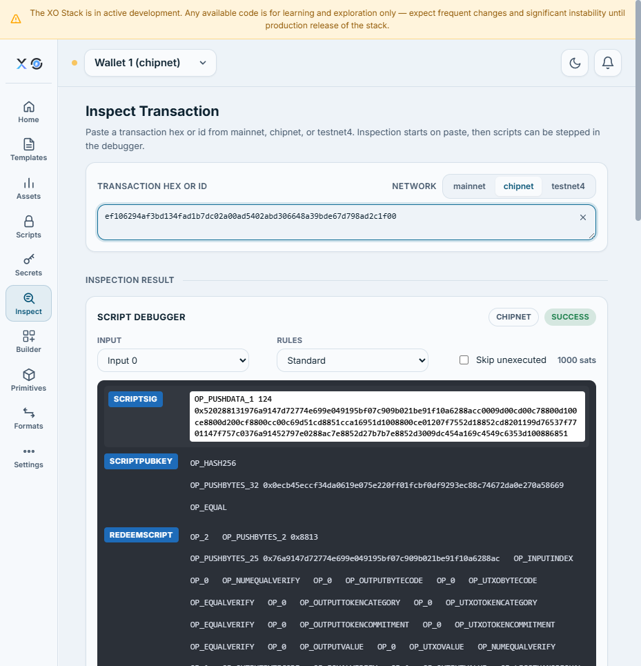

# Jelajah on XO (Build with XO / Migrate to XO bounties)

Jelajah's whole customer journey, **buy and stamp** and **claim the set**, written as an **XO template**: [`jelajah-stamp.template.json`](jelajah-stamp.template.json), source in [`jelajah-template.mjs`](jelajah-template.mjs).

The template's locking scripts **assemble to the exact bytes** of Jelajah's `StampMinter` and `RewardVault` covenants (CashScript 0.14, P2SH32). `buy-stamp.mjs` and `claim-set.mjs` check this before every run. So the template doesn't wrap a new contract: it spends the **same live minters** the Jelajah web app uses. That makes it a migration of existing Jelajah functionality to XO, and a novel XO template at the same time.

## What it does
Two actions for one role, `buyer`: `buyStamp`, then `claimSet` once stamps from 3 different stalls are in the wallet.

### `buyStamp`

| # | Input / output | Template entry |
|---|---|---|
| in 0 | the stall's minter coin, holding the rally's minting NFT | `minterInput` (unlocking: `minterUnlockingBytecode` = push of the redeem script) |
| out 0 | minter back to the covenant, unchanged | `minterOutput` → `stampMinter` locking script |
| out 1 | stall price to the stall | `paymentOutput` |
| out 2 | stamp NFT to the buyer, commitment = stall id ‖ buyer pkh | `stampOutput` |
| out 3 | change | engine (`addChangeToInvitation`) |

Like `faucet.cash`, a wallet can't find a stall's minter coin by itself, so `start` is empty and the rally app supplies the minter variables.

### `claimSet`
| # | Input / output | Template entry |
|---|---|---|
| in 0 | the rally vault: reward pool + the vault's minting NFT | `vaultInput` (unlocking: `vaultClaimUnlockingBytecode` = `OP_0` selects `claim()`, then the redeem script) |
| in 1..3 | the buyer's stamps, stall ids strictly increasing | the wallet's own P2PKH coins, added by the app (see note 7) |
| out 0 | vault back to itself, minus exactly one reward | `vaultOutput` → `rewardVault` locking script |
| out 1 | the reward to the buyer | `rewardOutput` |
| out 2 | trophy NFT, commitment `00 ‖ buyer pkh` | `trophyOutput` |
| out 3 | change (the burned stamps' dust) | engine |

The vault loops over in 1..3 on chain: same category, different stalls, all bought by the claimer. A set is only claimable if all its stamps were minted to one key, so `buy-stamp.mjs` now sends every stamp to one fixed receive address of the XO account (the default policy hands out a new address each time).

## Run it (chipnet)
```bash
cd xo && npm install && cd ..
node xo/buy-stamp.mjs 2          # stall 2 (Bakmi Jawa) on the chipnet rally; funds a throwaway XO account first
DRY=1 node xo/buy-stamp.mjs 2    # build + sign only, write xo/built.json
node xo/verify.mjs               # check built.json against the BCH 2026 VM with real chipnet source outputs
node xo/buy-stamp.mjs 1 && node xo/buy-stamp.mjs 3
DRY=1 node xo/claim-set.mjs && node xo/verify.mjs   # the claim, checked by the VM first
node xo/claim-set.mjs            # burn the set at the vault: reward + trophy
```

## Proof
- Transaction executed through the XO engine (`@xo-cash/engine` 0.1.1-next.18029697917): [`ef106294…`](https://chipnet.imaginary.cash/tx/ef106294af3bd134fad1b7dc02a00ad5402abd306648a39bde67d798ad2c1f00)
- Invitation used: [`invitations/buy-stamp-2-chipnet.json`](invitations/buy-stamp-2-chipnet.json)
- Inspected in the XO debug tool (blaze.xo.cash → Inspect, chipnet): **SUCCESS**; the redeem script shown is the StampMinter covenant. 
- The same minter is spent by the web app (WizardConnect) and by this XO template. Both produce identical stamps.
- **Full journey through XO** (engine `0.1.1-next.18230317763`), one buyer key: stamps at stall 1 [`ea15cdaa…`](https://chipnet.imaginary.cash/tx/ea15cdaabc50fe61542da4e49437e53da2a0f4ca6c542089652bffda805c7806), stall 2 [`514b9ad9…`](https://chipnet.imaginary.cash/tx/514b9ad975eb9509ac7bc6678c08f9e8152fea4c25138d0937c910ccb89c211e), stall 3 [`a2c48f4c…`](https://chipnet.imaginary.cash/tx/a2c48f4cf3728e9f4fe2afe12fc2d9ed45fb47277c92d488cef5476930dda4fa), then **the claim [`71ca9dee…`](https://chipnet.imaginary.cash/tx/71ca9deebc3f056becba02cd2702d6579ba2a5465c9df7425bb38329596fc7be)**: vault 170,000 → 160,000 sats, 10,000 to the buyer, trophy `00e6790e…`. The dry run was checked by `verify.mjs` first (VALID under the BCH 2026 VM). Invitations: [`invitations/`](invitations/).

## Raw engineering notes (facts for the feedback write-up, not the feedback itself)
The bounty asks for personally written feedback, so these are only the facts observed while building:

1. **NFT commitment expressions are decoded as UTF-8.** `resolveTemplateTokenNft` compiles a `$(…)` commitment with `evaluationDecodeMode: "utf8"`, then parses the text as hex. A script that computes raw bytes (`<merchantId> <buyerLockingScript> OP_3 OP_SPLIT …`) produced a garbled 11-byte commitment instead of 21 bytes. Workaround: pass the commitment hex as a `string` variable. The covenant still enforces the real rule on chain.
2. **`listOwnInputIndexes` leaves out contract inputs**, while `listMissingRequirements` still lists the contract input as unsigned. The fix was to pass `unlockingBytecode` on the input in `createInvitation`. Signing it via `signInvitation(0)` fails with `InputUnspentOutputUnavailableError` (not tracked).
3. **Dry runs keep inputs reserved** across process restarts. `archiveInvitation` releases them; without it, the next run fails with a reservation conflict.
4. **Variable typing:** `bytes` / `locking_script` values given as hex strings compile correctly. `token_category` must be a 64-character hex string, not a `Uint8Array`.
5. After a successful broadcast, `engine.stop()` / Electrum threw `blockchain.transaction.subscribe … not the shape the protocol defines` (chipnet Fulcrum). The transaction itself was fine.
6. While debugging, assembling the template's CashASM with libauth and diffing it against CashScript's redeem bytecode was the fastest way to get a byte-exact port.

7. **No way to declare "N inputs of this kind".** `claimSet` burns `needed` stamps that a loop in the covenant checks, but a template input is one fixed slot. The stamps go in as untyped wallet inputs in stall-id order, so the template alone doesn't tell a wallet what the claim spends; the covenant still rejects a wrong set.
8. **Engine start-up syncs block headers** from its checkpoint (`The requested header is ahead of the current checkpoint`), and until it catches up, `listSpendableUnspentOutputs` can be empty for an account that has coins. The scripts now wait for the account's known coins before funding it again.
9. With engine `0.1.1-next.18230317763`, `executeAction` broadcast successfully but then threw `UnspentOutputNotFoundInStoreError` (buy) or `DatabaseClosedError` (claim) while releasing reservations. `claim-set.mjs` saves the invitation before executing and confirms the claim by checking that the vault coin moved.

## Not yet
- Mainnet run (the XO bounty itself is judged on chipnet).
